# Coy Discover 💌

Ira’s pottery class took over her kitchen. Rohan will trade a chess lesson for a cooking lesson. **Coy Discover** gives you 30 illustrated profiles to explore and a small detail from each one to start a conversation. A match appears when the interest goes both ways. ♥

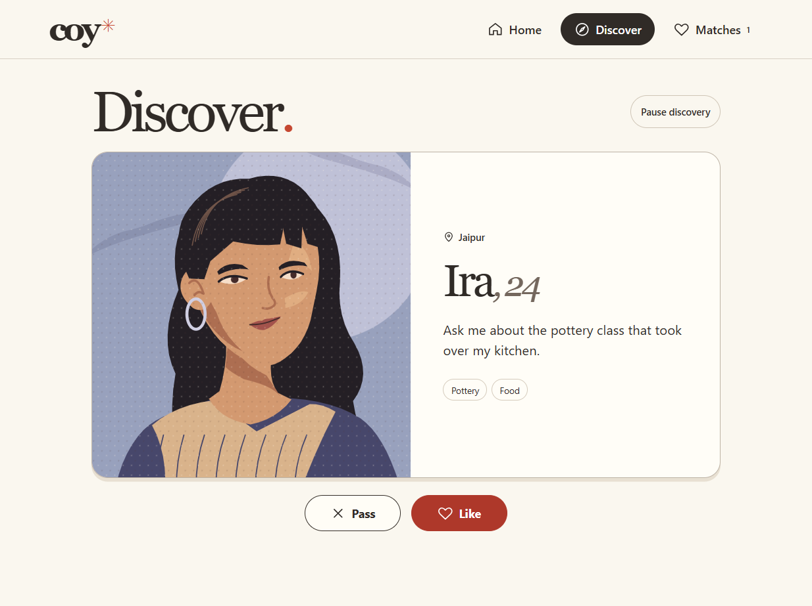

## 🎬 Take it for a spin

| Gesture | What happens |
| --- | --- |
| 👆 Tap a profile | Open the full profile, edit a suggested opener, or tap **Try something new**. **Send** saves the text on this device for the demo. |
| 🔎 Press and hold | Peek at the bio and interests over a blurred backdrop. |
| 💘 Drag right or left | The heart or cross travels with the top-right corner of the card. Release past the threshold to like or pass. A short drag settles back. |
| 🤝 Like a mutual admirer | See the match reveal and find that person again under **Matches**. |
| ☕ Pause discovery | Take a break and resume at the same card during the session. |

## 📸 Desktop walkthrough

| 🎉 A mutual match | 💞 The matches shelf |
| --- | --- |
| 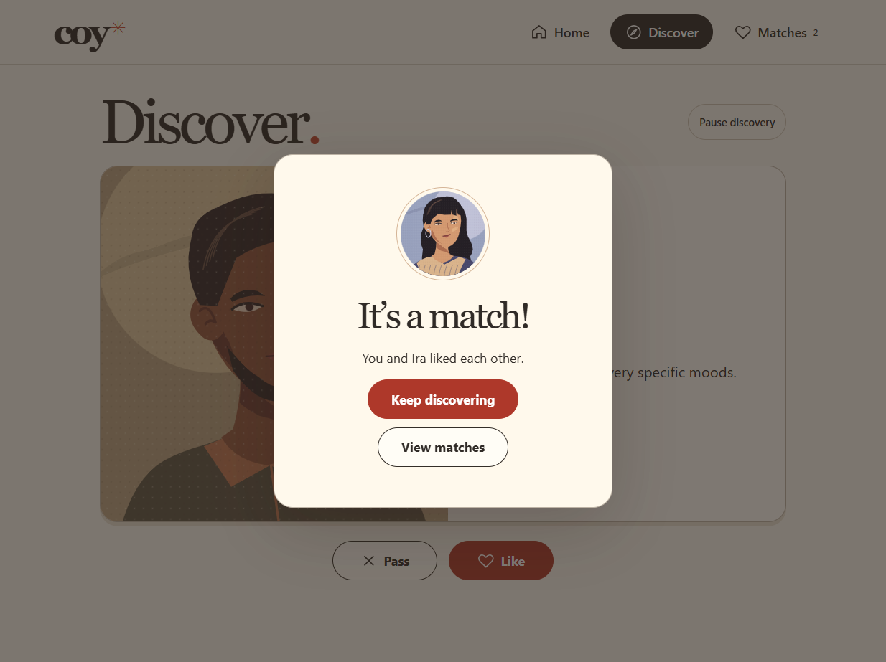 | 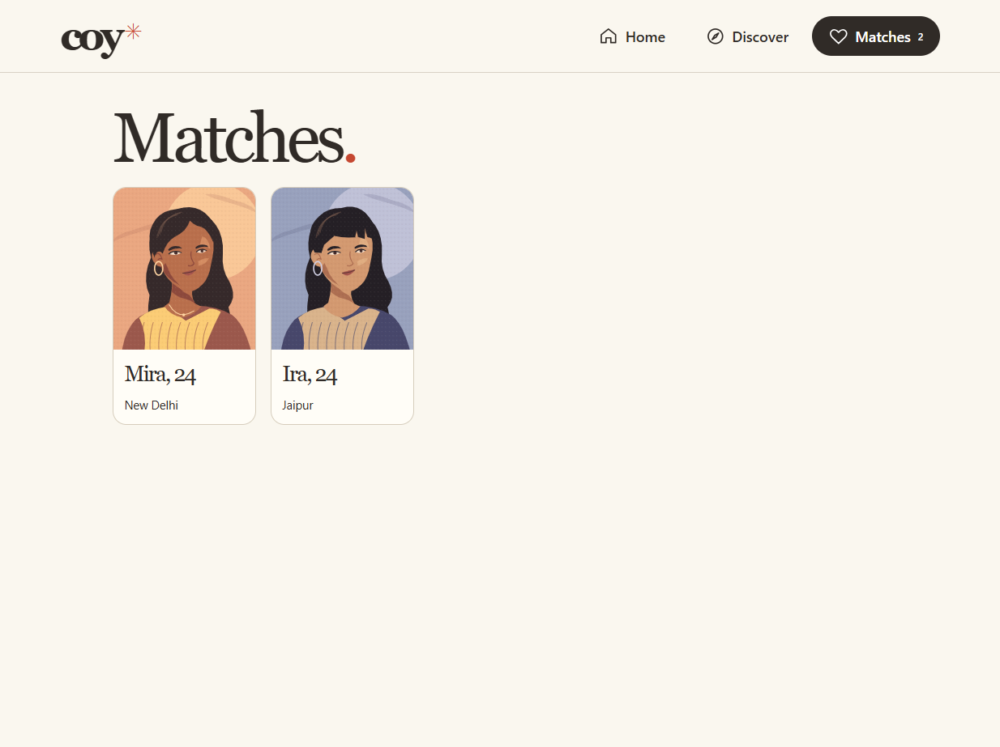 |
| **🔍 Hold to peek** | **💬 Tap to write** |
| 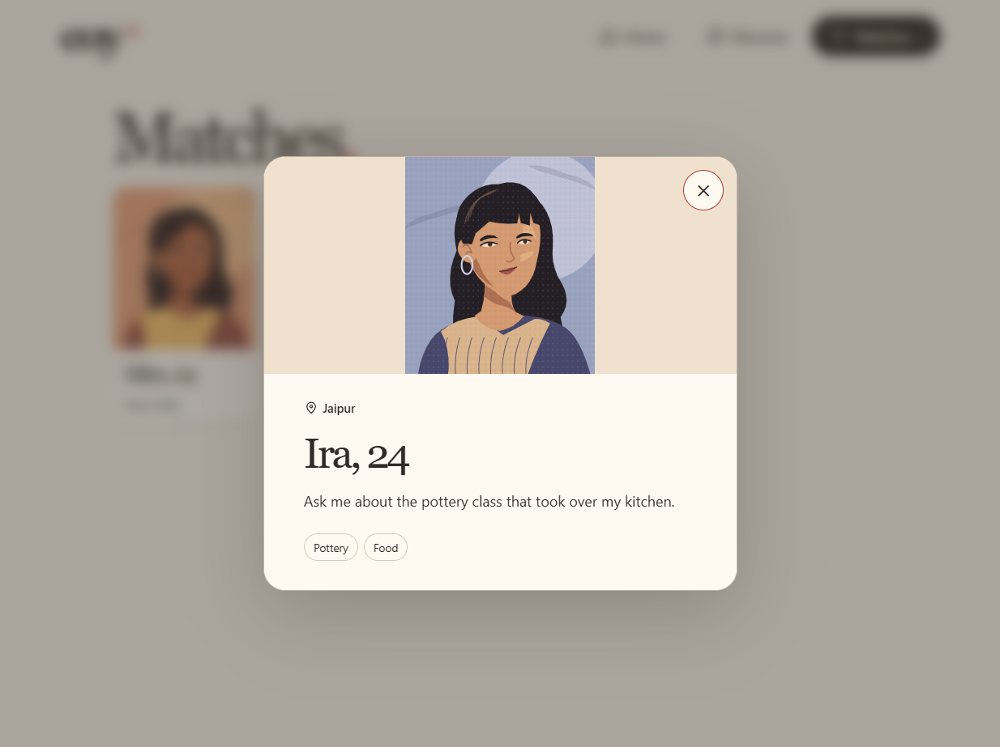 | 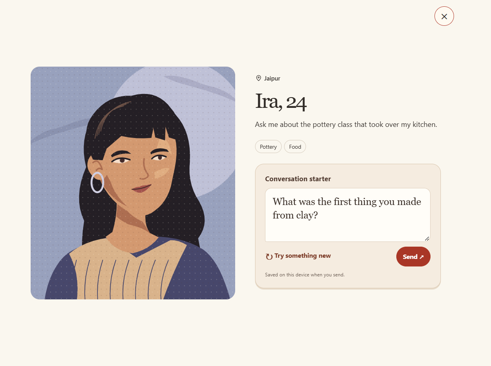 |

<details>
<summary>📱 Open the mobile gallery · 7 screenshots</summary>

| Discover | Swipe | Matches |
| --- | --- | --- |
| 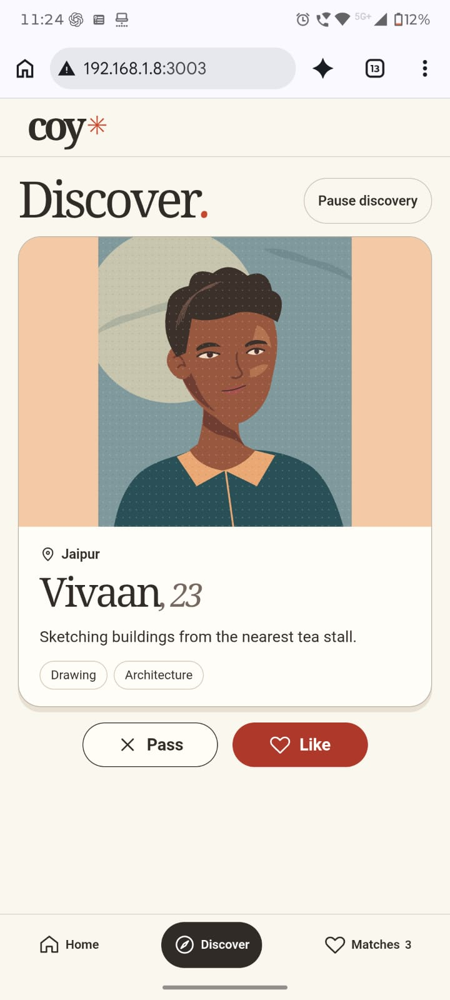 | 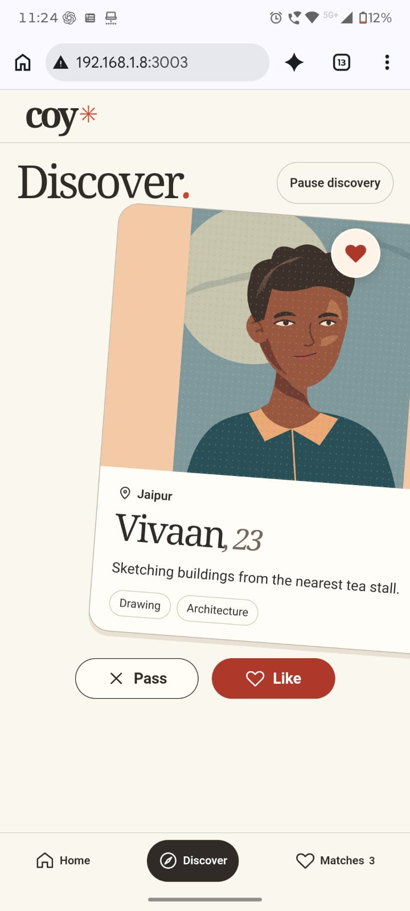 | 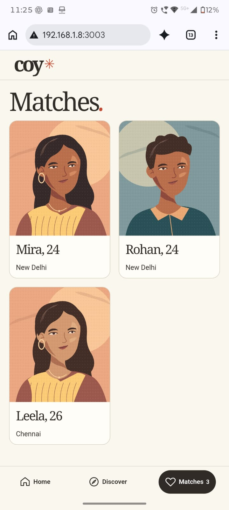 |

| Peek at Mira | Peek at Om | Write to Rohan |
| --- | --- | --- |
| 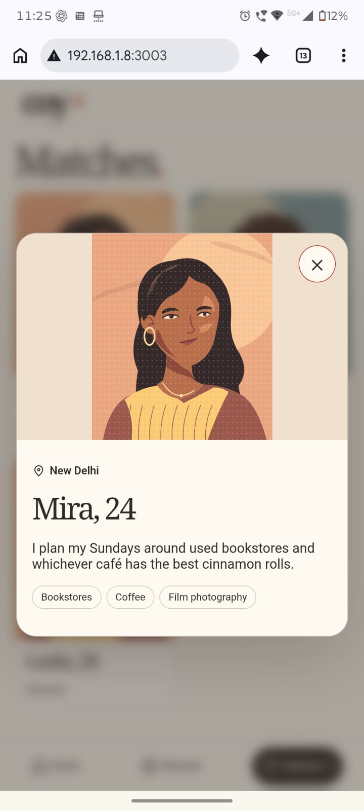 | 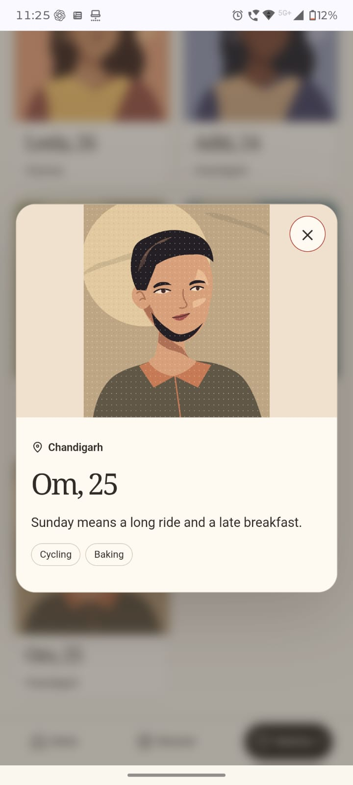 | 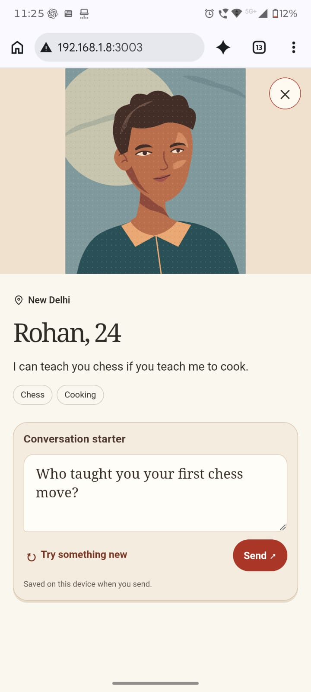 |

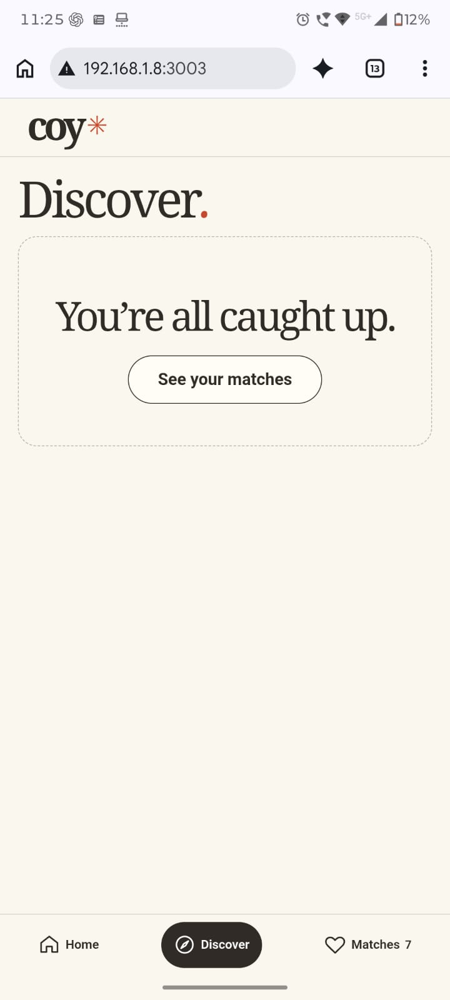

</details>

## 🚀 Run locally

Install **Node.js 22.13 or later**, then run these commands from the project folder.

```sh
npm install
npm start
```

Open [localhost:3000](http://localhost:3000). On a fresh database, like **Mira** to see a mutual match, then like **Kabir** to try a one-sided like. Refresh and check which profiles remain in the feed.

## 🛠️ Under the hood

**React** handles pointer gestures and profile dialogs. **Express** serves the API and bundled client. **SQLite** stores the single demo user’s swipes in `data/coy.sqlite`. The build includes every portrait locally.

| Endpoint | Behavior |
| --- | --- |
| `GET /feed` | Returns unseen profiles with public fields. |
| `POST /swipe` | Accepts `{"profileId":1,"direction":"like"}` or a pass. Returns whether a mutual match was created. |
| `GET /matches` | Lists mutual matches derived from saved decisions. |

🔒 Incoming likes stay on the server. A unique database key prevents duplicate swipes, including simultaneous requests. Visual feedback accompanies the audio cues, supported devices add haptics, and reduced-motion preferences are respected.

## 🧪 Build and test

```sh
npm run build
npm test
```

Rebuild after editing JSX. The API tests use an isolated database to check privacy, invalid votes, concurrent swipes, persistence across restart, mutual matches and the end of the feed.

## 🌱 Two ideas for Coy

1. **Small-group plans.** Let users opt into a badminton game or café meetup with a fixed group size and an upfront per-person cost. This gives someone with few matches a concrete way to meet others. Offer a waitlist and collect payment only when enough people confirm.
2. **Private invite preview.** Before a crush invite is shared, show exactly what the recipient will see and let the sender revoke the link. This helps the sender decide whether a forwarded invite could reveal more than they intended.

These are proposals pending a firsthand walkthrough of Coy’s phone OTP, crush, verification, invite, and extra-slot flows.
